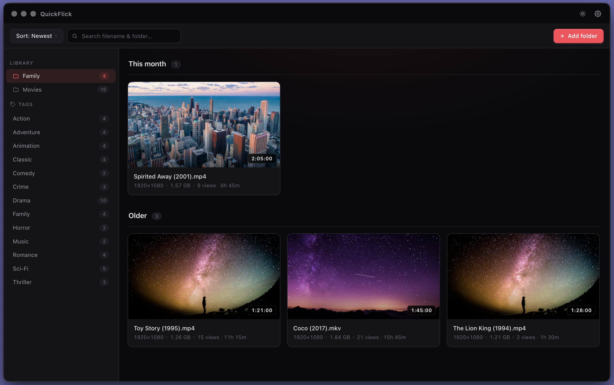

# QuickFlick

QuickFlick shows videos on macOS.
You select a folder. The app shows the videos in a grid.



## Functions

- Scan a folder and all subfolders for video files.
- Support these file types: mov, mp4, mkv, webm, m4v, avi, flv, wmv, mpg, mpeg, 3gp, m2ts, ts, hevc.
- Make 8 thumbnails for each video.
- Show the thumbnails in a grid.
- Move the pointer over a thumbnail to preview the video.
- Click a thumbnail to open the video in the default video player.
- Right-click a thumbnail to show the file in Finder.
- Filter videos by subfolder.
- Search videos by file name.
- Scan the folder again manually and show the progress.

## Requirements

- Use macOS.
- Install ffmpeg and ffprobe and put them on the PATH:
  ```bash
  brew install ffmpeg
  ```

## How to use

1. Install the software:
   ```bash
   yarn install
   ```
2. Start the app:
   ```bash
   yarn dev
   ```
3. Select a folder with videos.
4. Browse the grid.
5. Use search to find a file name.
6. Use the sidebar to filter by subfolder.
7. Click a video to play it.
